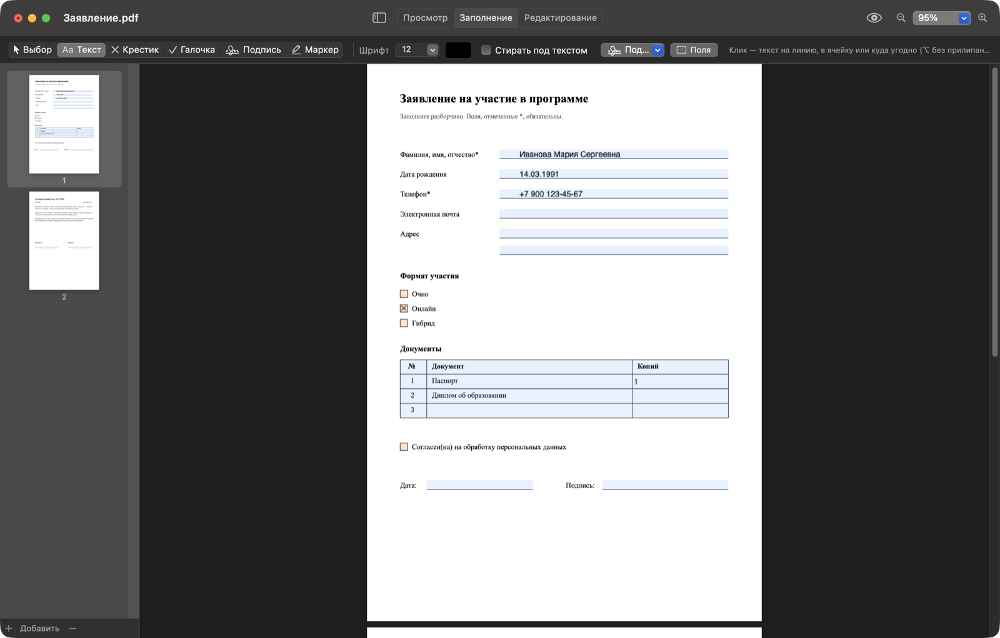
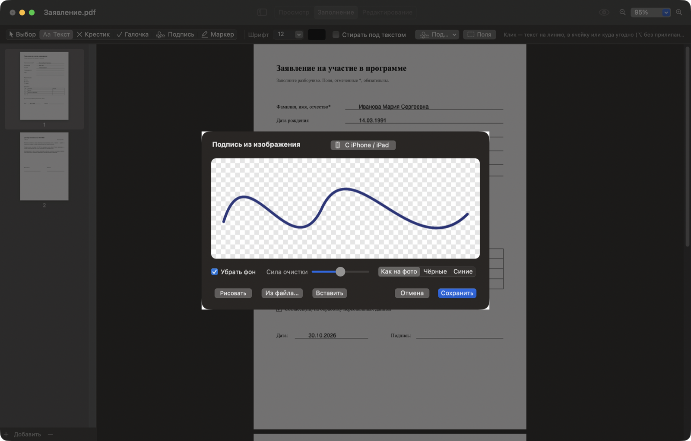
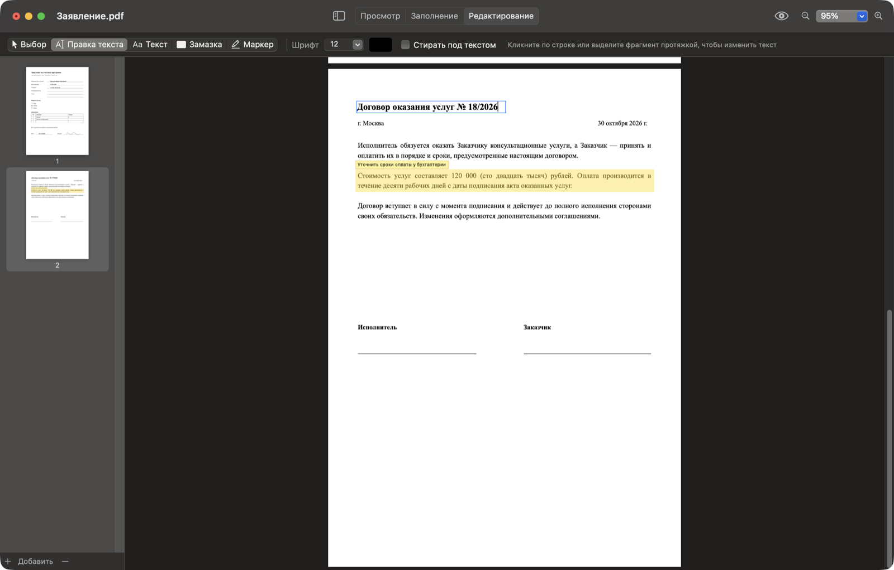
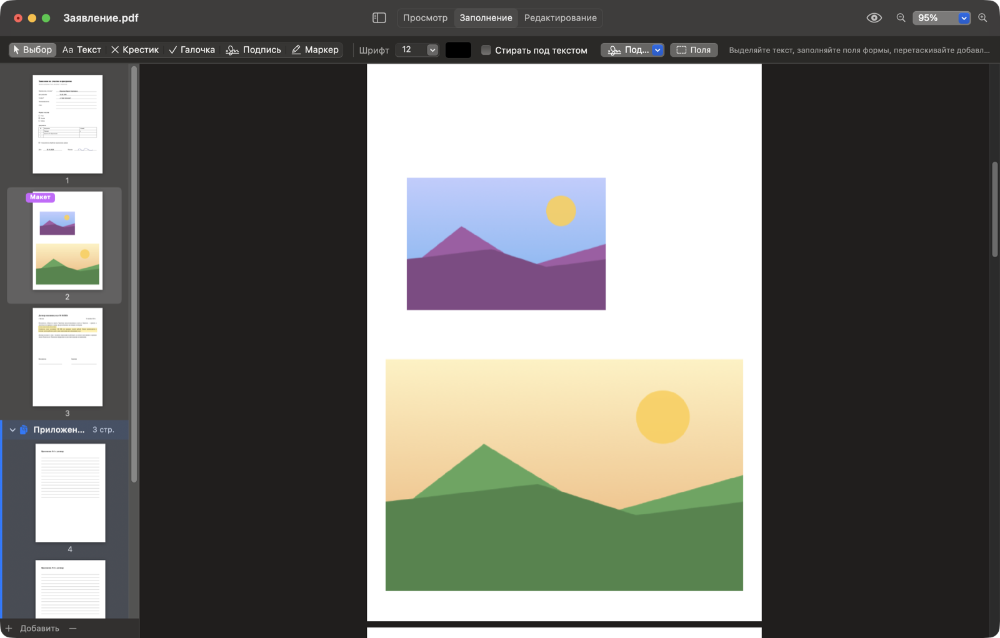

# PageYard

Просмотр, заполнение и редактирование PDF на macOS. Заполняет формы, в которых нет полей, ставит
подписи и отметки, правит текст прямо в документе, собирает PDF из страниц, картинок и документов.

## Скачать

**[Последняя версия →](https://github.com/veryevilzed/pageyard/releases/latest)**, файл `PageYard_*_universal.dmg`:
откройте его и перетащите PageYard в «Программы». Сборка универсальная (Apple Silicon и Intel), macOS 13+,
подписана Developer ID и нотаризована Apple, поэтому открывается без предупреждений.
Что нового — в [CHANGELOG](CHANGELOG.md).

## Возможности

Три режима вверху окна: **Просмотр / Заполнение / Редактирование** (⌘1 / ⌘2 / ⌘3). Под ними строка
инструментов текущего режима, в «Просмотре» её нет.

### Заполнение

PDF без настоящих полей заполняется так же легко, как форма. PageYard находит линии `____`, ячейки
таблиц и квадратики (кнопка «Поля» подсвечивает их), и текст с отметками к ним прилипает:
клик рядом с линией ставит текст ровно на неё, клик в квадратик — крестик по центру.
Обычные поля PDF-форм тоже работают.

| Клавиша | Инструмент |
|---|---|
| T | **Текст.** Клик — строка на линии, в ячейке или где угодно (⌥ — без прилипания). Протяжка — область с переносом строк |
| X / C | **Крестик / Галочка.** После отметки инструмент возвращается к «Выбору»; с ⇧ остаётся для следующих |
| S | **Подпись.** Из сохранённых, ставится на линию подписи |
| H | **Маркер.** Жёлтый блок с заметкой |
| V | **Выбор.** Двигать и менять размер добавленного, ⌫ удаляет, стрелки сдвигают; ⌘C / ⌘X / ⌘V / ⌘D — копировать, вырезать, вставить, дублировать |

### Подписи

Подпись можно нарисовать мышью или трекпадом, загрузить фото или скан, вставить из буфера
(например, скопированную в Просмотре) или нарисовать на iPhone / iPad. С фото фон убирается:
бумага, тени и неровный свет становятся прозрачными, а цвет чернил можно оставить или сделать
чёрным / синим.

### Редактирование

| Клавиша | Инструмент |
|---|---|
| E | **Правка текста.** Клик по строке или протяжка по фрагменту — текст открывается тем же шрифтом и размером; при сохранении исходные символы удаляются из файла, а не закрашиваются |
| T | **Текст** с опцией «Стирать под текстом»: область закрывает то, что под ней, а старый текст удаляется |
| W | **Замазка** |
| H | **Маркер** с заметкой. Кнопка с глазом вверху скрывает все пометки |

### Страницы и сборка PDF

- Панель страниц слева: перетаскивание, поворот, удаление, экспорт.
- Многостраничный файл вставляется **группой** и двигается целиком, пока его не разгруппировать.
- **⌘N** — пустой документ. В окно или в панель можно перетащить PDF, картинки, Word / Pages,
  Excel / Numbers или импортировать скан с iPhone.
- Картинки встают отдельными листами своего размера или на **лист-макет** A4 / A5 / A3 / Letter,
  где их можно двигать и менять размер.
- **Копирование объектов:** ⌘C / ⌘V вставляет копию на текущую страницу; картинка или текст
  из другой программы вставляются объектом.
- **Файл → Экспорт:** текущая страница или выбранные страницы в PNG / JPEG, 72–600 DPI, и
  «PDF без аннотаций» — копия с исходными страницами, без добавленного и без комментариев файла.

### Перевод

Кнопка 文A вверху (⌘⇧T) открывает панель перевода через Claude или OpenAI. Сама по себе она ничего
не переводит — переводится только то, что попросили:

- выделите текст и нажмите «Перевести выделенное» (или правый клик по выделению);
  ⌥ + протяжка — перевести область рамкой; «Перевести страницу» — целиком;
- переключатель «Перевод» в панели: выкл — виден оригинал, вкл при выделенном тексте — переводится он;
- переведённая страница притемняется, перевод лежит белыми карточками на месте оригинала, шрифт
  подгоняется под место (длинный перевод вытягивает карточку, при наведении — полный текст);
- клик по карточке или «Убрать перевод» возвращает оригинал; пока идёт перевод, текст пульсирует
  с меткой «Перевожу…»;
- «В документ» переносит перевод страницы в файл вместо оригинала.

Ключ API и модель задаются в Настройках (⌘,), там же пошагово написано, где взять ключ.
Ключи хранятся в связке ключей macOS; текст отправляется сервису только при переводе.

### Сохранение

Текст, отметки, подписи и замазка вклеиваются в страницы, поэтому файл одинаково выглядит в любой
программе. Маркеры с заметками остаются настоящими PDF-аннотациями, и их можно скрыть где угодно.

Word и Excel конвертируются через LibreOffice, если он установлен, иначе через Pages / Numbers
(при первом использовании macOS спросит разрешение).

## Сборка из исходников

Нужны Xcode Command Line Tools (`xcode-select --install`) и Node 18+ для инструмента релиза.

    ./Scripts/build_mupdf.sh     # один раз: MuPDF из исходников, universal, macOS 13+
    npm run build                # build/PageYard.app (ad-hoc подпись)
    npm run dmg                  # + build/PageYard.dmg
    npm run selftest             # самопроверка без интерфейса
    npm run release              # подписанный и нотаризованный релиз

`npm run release` по шагам спрашивает версию, архитектуру и организацию Apple. Он сам находит или
выпускает сертификат Developer ID через App Store Connect API, подписывает с Hardened Runtime,
нотаризует `.app` и `.dmg`, проверяет Gatekeeper и публикует релиз на GitHub. Ответы без секретов
сохраняются в `.release.json`, организации — в `~/.config/apple-signing/` (общие с другими проектами).
`npm run release -- --yes` берёт сохранённые ответы, `-- --dry-run` показывает план без выполнения.

Скриншоты для README снимает само приложение на сгенерированном демо-документе:

    PAGEYARD_SCREENSHOTS=docs/screenshots build/PageYard.app/Contents/MacOS/PageYard

## Лицензия

Исходный код PageYard — [Apache License 2.0](LICENSE).

Готовые сборки включают [MuPDF](https://mupdf.com) (© Artifex Software, **AGPL-3.0**), которым
из файла удаляется исходный текст при правке и стирании. Поэтому бинарная сборка PageYard
распространяется на условиях AGPL-3.0; подробности — в [NOTICE](NOTICE).
